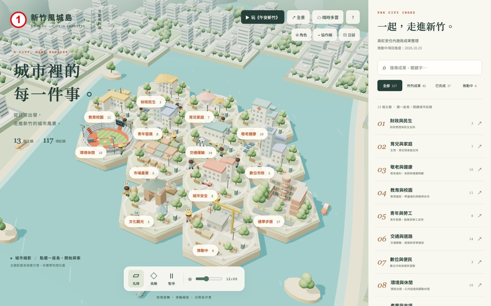
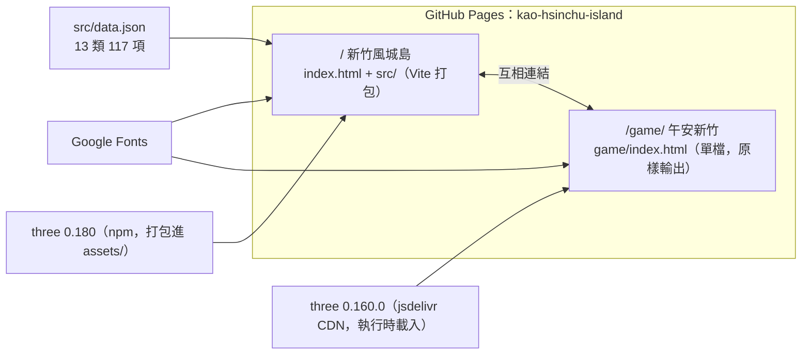
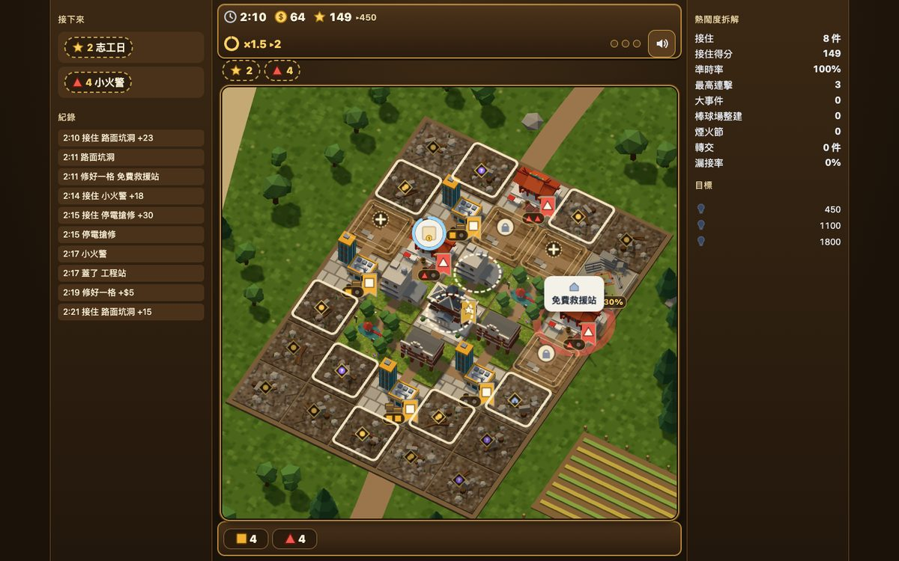
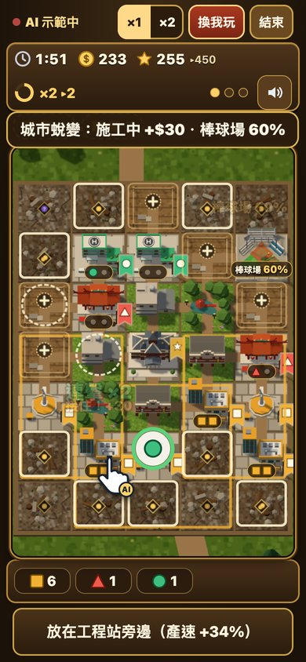
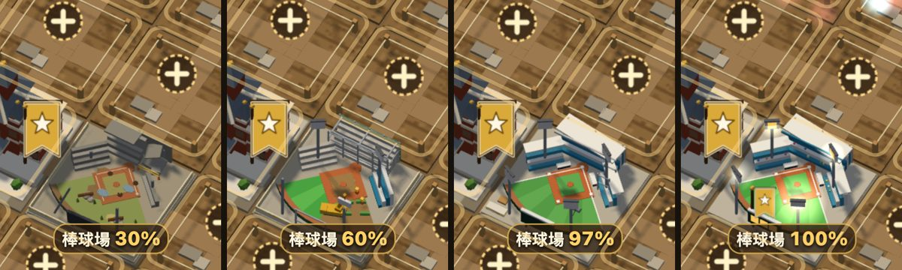

# 新竹風城島 × 午安新竹

用兩種方式認識新竹的城市建設：一個是可以慢慢逛的**互動資料城市**，一個是三分鐘一局的**城市小遊戲**。兩者放在同一個網站，各有自己的進入點。

| 進入點 | 路徑 | 內容 | 適合 |
|---|---|---|---|
| **新竹風城島** | `/`（根目錄） | 13 個主題、117 項施政整理的互動城市：主題選取、全文搜尋、狀態篩選、詳細資料、城市人物與步道 | 想查資料、慢慢看 |
| **午安新竹** | `/game/` | 以新竹地標為主題的城市經營小遊戲：修格子、蓋站、派人接住城市的需求，最後完成棒球場整建、迎接煙火節 | 想玩、想分享 |

網站：https://smallmouth.github.io/kao-hsinchu-island/ （遊戲：https://smallmouth.github.io/kao-hsinchu-island/game/ ）

兩個頁面互相連結：風城島右上角的「▶ 玩《午安新竹》」（視窗寬度 1150px 以下改在品牌名稱下方，顯示「▶ 遊戲」）進入遊戲；遊戲首頁下方的「← 新竹風城島」回到資料城市。





## 快速開始

```sh
npm ci
npm run dev          # 開 http://127.0.0.1:5173/ 是風城島，/game/ 是遊戲
npm run build        # 兩個進入點一起輸出到 dist/（dist/index.html、dist/game/index.html）
npm run preview      # 檢查建置結果
```

## 專案結構

```text
index.html               新竹風城島進入點
src/                     風城島程式（場景、人物、步道、介面、資料）
  data.json              13 類 117 項施政整理
game/
  index.html             午安新竹進入點（單一 HTML 檔：樣式、遊戲邏輯、3D 繪製都在裡面）
  tests/                 遊戲的 Python + Playwright 測試
tests/                   風城島的單元測試（node --test）與瀏覽器測試（Playwright）
docs/                    風城島的資料說明、架構說明、原始整理檔
docs/img/                README 用截圖
vite.config.js           兩個進入點（index.html、game/index.html）
.github/workflows/       合併到 main 後部署 GitHub Pages
```

---

## 新竹風城島（`/`）

以互動城市呈現使用者提供的施政整理：13 個主題、117 項紀錄。原創 Three.js 城市模型，提供主題選取、全文搜尋、狀態篩選、詳細資料、鳥瞰、日照及動畫控制。另有可自訂角色、28 位城市人物、10 條示意協作線、搬運徽章、步道行走、鏡頭跟隨、拍照定點及城市日誌。手機使用底部清單；WebGL 不可用時，仍能從清單閱讀全部內容。

模組與場景說明見 `docs/architecture.md`。

### 資料

- `src/data.json`：13 類 117 項；標題及敘述保留來源原文。
- `docs/施政成果整理.md`：使用者提供的原檔。
- `docs/content-notes.md`：分類方式、疑義、日期適用範圍。
- `docs/architecture.md`：城市場景、角色、路徑與介面模組說明。
- `docs/通學步道.md`：第十三類「通學步道」的 27 項原文名稱。

### 閱讀說明

- `reported` 是「資料所列成果」，不是獨立核實或全部完成。
- `pending` 對應原文第十二類的 8 項。
- 第 3、22、84、86 項有來源敘述待核對提示。
- 沒有新增已查證的政策關係、官方來源、地理座標或成果數字；10 條角色路線明確標示為視覺示意。
- 第十三類「通學步道」收錄 `docs/通學步道.md` 的 27 項原文名稱；使用者於 2026-10-25 確認全部完成，另以 `completed` 狀態呈現。未提供逐項完工日期。
- 城市是主題示意，不是新竹地理或建物現況模型。

---

## 午安新竹（`/game/`）

| 桌機 | 手機 |
|---|---|
|  |  |

### 怎麼玩

一局 3 分鐘（悠閒模式時間較寬鬆）。

1. **修格子、蓋站**：點灰色瓦礫格修好它，在空地蓋站。站分四色：工程（橘）、救援（紅）、照護（綠）、交通（藍），會持續產出人手。
2. **接住泡泡**：城裡冒出需求泡泡（停電、小火警、路面坑洞……），在倒數結束前點它，派對應顏色的人手出動。
3. **加成站**：風城風車放在站旁邊，能讓周圍的站產得更快。
4. **城市蛻變**：分數到門檻時城市換階段，同時推進棒球場整建。
5. **棒球場整建**：整局都看得到棒球場一步步修好（30% → 60% → 97%）；最後 3% 由玩家點擊完工，燈柱亮起。
6. **煙火節**：最後三波大量需求，接住越多分數越高；結算時依分數點亮 1～3 盞燈。

首頁的「看 AI 示範」會由 AI 從開局玩到結算，邊玩邊用字幕說明。

### 建築與新竹地標

預設是「新竹地標」建築組；建築只是造型示意，不代表實際位置或現況。

| 遊戲裡的建築 | 造型 |
|---|---|
| 市政府（畫面中心） | 新竹市政府（前新竹州廳）：對稱二層紅磚、黑瓦屋頂、中央主塔與門廊 |
| 工程站 | 科學園區：玻璃帷幕大樓＋白色廠房 |
| 救援站 | 城隍廟：紅柱、燕尾脊、剪黏、廟埕小吃攤 |
| 照護站 | 醫療長照中心：頂樓直升機停機坪、救護車（泛用造型，不使用任何醫院標誌） |
| 交通站 | 新竹火車站：中央鐘塔、拱窗、月台與列車 |
| 加成站 | 風城風車：白色三葉風力發電機 |
| 主要工程 | 新竹市立棒球場：損壞 → 整修 → 收尾 → 完工亮燈 |
| 一般房子 | 竹塹街景：紅磚騎樓街屋、有水塔的透天厝、新竹公園麗池 |



遊戲文案只描述遊戲內發生的事，不包含真實日期、金額或可查證的具體宣稱。

### 網址參數

在網址後加 `#` 參數，可用逗號組合（例如 `game/#aoe,demo`）：

| 參數 | 作用 |
|---|---|
| `#demo` | 開頁直接進入 AI 示範 |
| `#aoe` | 改用另一組建築造型（中世紀風） |
| `#2d` | 改用 2D 灰盒畫面（WebGL 不可用時也會自動退回 2D） |
| `#debug` | 顯示除錯面板：規則數值、相機角度、建築造型切換 |

### 遊戲測試

遊戲測試使用 Python 版 Playwright，直接開 `game/index.html`（`file://`），不需要先啟動 dev server：

```sh
pip install playwright && python3 -m playwright install chromium
python3 game/tests/smoke.py            # 快速整局檢查
python3 game/tests/play.py             # 真實點擊玩整局（桌機與手機視窗）
python3 game/tests/stadium_demo.py     # 棒球場整建進度與文案
python3 game/tests/art.py click        # 高建築點擊落點
RENDERER=2d python3 game/tests/play.py # 用 2D 畫面跑同一組測試
ART=aoe python3 game/tests/smoke.py    # 用另一組建築造型
```

- 3D 測試用 SwiftShader 軟體繪製 WebGL（測試已帶 `--use-angle=swiftshader --enable-unsafe-swiftshader`），3D 測試請一次只跑一組，同時跑多組可能讓 WebGL 起不來而退回 2D。
- 截圖輸出到 `game/shots/`（已列入 `.gitignore`）。
- 其他測試：`booster.py`（加成站）、`review_fix.py`、`round3.py`（歷次修正的回歸）、`demo.py`（AI 示範整局，約 8 分鐘）、`verify3d.py`（效能與記憶體）、`balance.py`（數值模擬）、`visual.py`。

### 修改遊戲

- `game/index.html` 是遊戲唯一的原始檔，直接編輯即可，沒有建置步驟。它只用內嵌的一般 `<script>` 與 CDN 網址，Vite 建置時輸出的 `dist/game/index.html` 與原檔相同；如果之後加入 `<script type="module">` 或相對路徑的圖片、樣式，Vite 會打包並改寫路徑，遊戲測試（直接開 `file://`）也要跟著調整。
- 遊戲在執行時從 jsdelivr 載入固定版本的 `three@0.160.0`，與風城島打包的 three 0.180 分開，兩邊互不影響。
- 規則數值集中在檔案裡的 `RULES` 物件，也可以用 `#debug` 面板即時調整試玩。
- 最高分與音效設定以 `cc_` 開頭的鍵存在瀏覽器 localStorage，和風城島的 `hsinchu-island-avatar:v1` 不衝突。

---

## 驗證

```sh
npm test               # 風城島：資料、路徑、角色狀態
npx playwright test    # 風城島：桌面及手機互動
npm run build          # 兩個進入點一起建置
```

Playwright 預設使用 macOS 已安裝的 Google Chrome；其他平台可設定 `PLAYWRIGHT_CHROMIUM_EXECUTABLE_PATH`，或 `npx playwright install chromium` 後使用 Playwright Chromium。遊戲測試見上方「遊戲測試」。

## 部署（GitHub Pages）

合併到 `main` 後，GitHub Actions 會安裝依賴、執行單元測試及建置，再將 `dist/`（含 `dist/game/`）部署至 GitHub Pages。建置時從 Pages 設定取得 base path，確保專案子路徑下的資源正常載入；兩個頁面之間的連結都用相對路徑。`develop` 與功能分支不會部署。

## 分支

`develop` 為開發整合分支。功能分支從 `develop` 建立，完成後以 PR 合併回 `develop`；發版時再由 `release/x.y.z` 合併到 `main`。

## 隱私與外部資源

- 沒有後端或追蹤碼。
- 風城島的角色外觀與自訂姓名、遊戲的最高分與設定，都只存在目前瀏覽器的 localStorage，不上傳。
- 外部資源：Google Fonts（兩個頁面；載入失敗時使用系統字型），以及遊戲的 three.js（jsdelivr CDN）。

## 已知限制與後續

- 遊戲的 three.js 從 CDN 載入，離線時無法進入 3D 畫面（會退回 2D）；之後可改為和風城島共用打包的 three，需要先完整回歸測試。
- 遊戲的 Python 測試目前沒有接進 CI，只有風城島的 `npm test` 會在部署前執行。
